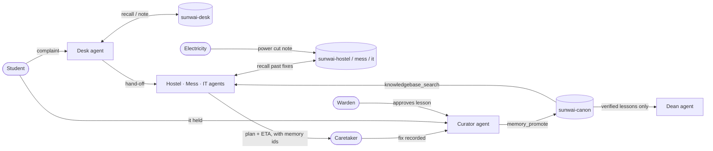

# Sunwai · सुनवाई

**Campus grievances, heard and remembered.**

Students complain in their own words. AI agents with shared [Meko](https://docs.mekodata.ai) memory merge duplicate
reports, recall how the same fault was fixed before, and pass on what other departments know. People approve every
call that matters. A fix becomes campus knowledge only after **the students it affected confirm it held and a warden
approves it**, so the dean sees verified patterns, not anecdotes.

Built in 24 hours at **hackCBS 9.0** for the Meko challenge, Track B: Campus Grievance Swarm, by **Team Syzygy**.

**[Live app](https://sunwai-lpf8.onrender.com)** · **[Swarm view](https://sunwai-lpf8.onrender.com/swarm.html)** · **[Design note](DESIGN.md)** · **[Meko feature proposal](FEATURE_PROPOSAL.md)** · **[Measured results](result.md)** · **[Submission](SUBMISSION.md)**

---

## The problem

Forty students report one dead router in five places. Nobody hears back, so they complain again, louder. Last
winter's geyser fix is forgotten by this winter. Electricity knows about tomorrow's power cut, but the geyser repair
gets booked into it anyway. The caretaker who knew why the RO filter fails is transferred. The dean hears the loudest
complaint of the week, not the verified pattern behind it.

Campuses already have forms. What they lack is **context that reaches the right person at the right time and gets
better with every fix.**

## What Sunwai does

| | |
|---|---|
| **Many reports → one incident** | 40 Wi-Fi complaints in Hinglish, typos and anger become one IT incident with "39 others reported this". |
| **Plans that remember** | The Hostel agent recalls last winter's fix and the fixes that failed, and proposes a plan that cites them. |
| **Departments that talk** | Electricity records a power cut; it lands in the Hostel and IT agents' memory and the geyser's ETA moves, with the reason shown to the student. |
| **Honest status** | The student always sees where their complaint stands, the ETA, and *why*. |
| **Verified lessons** | Fixed → students confirm it held → warden approves → the lesson is promoted to campus canon. Agents never promote alone. |
| **Next case, done right** | A geyser complaint in another hostel is dispatched with the verified fix and an honest 40-minute ETA. |
| **Leadership on facts** | The Dean agent reads only canon: "RO water needed a verified fix 4 times, about every 40 days; next one due ~17 Nov." |
| **Swarm view** | A live board of every person, agent and Meko call: who wrote, recalled, shared and promoted what, with counters and replay. |

## Meko on vs off (measured)

The same 57-step scripted run, same local model ([result.md](result.md)):

| | Meko **on** | Meko **off** |
|---|---|---|
| Incidents from 49 student reports | **4** (Wi-Fi 40→1, mess 5→1 escalated as food safety) | 49, one per report |
| Power cut at Hostel A | Written into Hostel + IT memory; the ETA moves and cites it | Nobody knows |
| Repeat geyser case in Hostel B | "Verified fix from INC-0001: reset the breaker, set the thermostat to 55 °C", **ETA 40 min** | "Inspect the geyser. No past fix on record." |
| Meko calls | 47 (27 recalls, 7 notes, 6 shares, 6 approvals, 1 promotion), 0 errors | 0 |

## How it works



- **One Meko datapack per agent** (`sunwai-desk`, `-hostel`, `-mess`, `-it`, `-canon`, `-dean`). Departments share by
  writing a note *into the receiving agent's datapack*, which shows up as one orange edge in the swarm view.
- **People make the calls.** Agents propose; caretakers approve plans and record fixes; students confirm; wardens
  approve lessons. Only then does the Curator call `memory_promote`.
- **Nothing is shown as context that Meko didn't return.** Every context card shows its datapack and memory id.
- **Private by default.** Students appear only as `S-xxxx`; phone numbers, emails, roll numbers and names are scrubbed
  before anything reaches Meko (33 tests). Anything simulated is badged `SCRIPTED`.
- **Every Meko call goes through one client** (`sunwai/meko.py`), which logs it. The swarm view is drawn only from
  that log.

Full detail: [DESIGN.md](DESIGN.md).

## Open model, on our own laptop

The agents run on **Qwen3 through [Ollama](https://ollama.com)**, on our own GPU: `qwen3:8b` on the RTX 4060 demo
laptop, `qwen3:4b-instruct` on the 4 GB dev laptop (10/10 valid tool calls, 9/10 correct, p50 3.1 s). Each agent does
one narrow job (classify, extract, draft) with a tool call, and a deterministic state machine owns the flow, so a
small model is reliable and the demo never stalls. Any OpenAI-compatible server works: change `LLM_BASE_URL` in `.env`.

## Run it (4 commands)

Needs [uv](https://docs.astral.sh/uv/), [Ollama](https://ollama.com) and a free Meko API key from
[cloud.mekodata.ai](https://cloud.mekodata.ai) (Settings → API Keys).

```bash
git clone https://github.com/Atharv-tw/sunwai.git && cd sunwai
```

```bash
cp .env.example .env    # paste your Meko key into MEKO_API_KEY
```

```bash
ollama pull qwen3:4b-instruct
```

```bash
uv run sunwai
```

Open **http://127.0.0.1:8765**: pick a role, or open the swarm view. With 8 GB of GPU memory, use `qwen3:8b`
(`LLM_MODEL=qwen3:8b` in `.env`). Don't use plain `qwen3:4b`: on Ollama it is now a thinking-only build that took
~90 s per call.

Optional, to load the seeded campus history and play the whole demo script:

```bash
uv run python scripts/seed_history.py && uv run python scripts/run_scenario.py --speed 2
```

## Hosted version

**https://sunwai-lpf8.onrender.com** runs the same code on Render with live Meko. The open model stays on our
laptop: the hosted app reaches the laptop's Ollama through a Cloudflare tunnel (see [4060.md](4060.md#hosted-link)).
When the laptop is offline, the Desk falls back to keyword triage; Meko memory, the hand-offs and the swarm view still
work. The free instance sleeps when idle, so the first request can take ~50 s.

## Built with Meko, by coding agents

While building, our coding agents (Claude Code) shared a separate build datapack, **`syzygy-build`**. Every
team-wide decision was saved there, signed with its author, and promoted: decisions from Atharv and Alok, mirrored in
[decisions.md](decisions.md). The protocol is in [CLAUDE.md](CLAUDE.md) / [AGENTS.md](AGENTS.md). The product never
reads `syzygy-build`, and coding agents never touch the `sunwai-*` datapacks.

## Repo map

| Path | What |
|---|---|
| `sunwai/meko.py` | The only Meko client: conversations, schema-checked arguments, call log |
| `sunwai/orchestrator.py`, `sunwai/store.py` | Incident state machine and SQLite store |
| `sunwai/agents/` | Desk, department (Hostel / Mess / IT), Curator, Dean |
| `sunwai/privacy.py` | PII scrub and pseudonymous student ids |
| `sunwai/incident_api.py`, `sunwai/swarm_api.py` | Incident API and swarm view API (calls, live events, graph) |
| `web/` | Plain HTML/CSS/JS: role screens and the swarm view, no build step |
| `scenarios/` | Modelled campus, seeded history, live demo script |
| `scripts/` | Smoke tests, scenario runner, seed and reset |

## Docs

[DESIGN.md](DESIGN.md) design note · [FEATURE_PROPOSAL.md](FEATURE_PROPOSAL.md) Meko feature proposal ·
[result.md](result.md) measured numbers · [decisions.md](decisions.md) every decision and why ·
[research.md](research.md) references and Meko friction log · [CHECKLIST.md](CHECKLIST.md) problem-statement checklist ·
[SUBMISSION.md](SUBMISSION.md) submission links · [4060.md](4060.md) demo-laptop runbook · [plan.md](plan.md) build plan

## Team Syzygy

Atharv · Alok · Arun. Built with Meko by YugabyteDB at hackCBS 9.0. MIT licensed.
